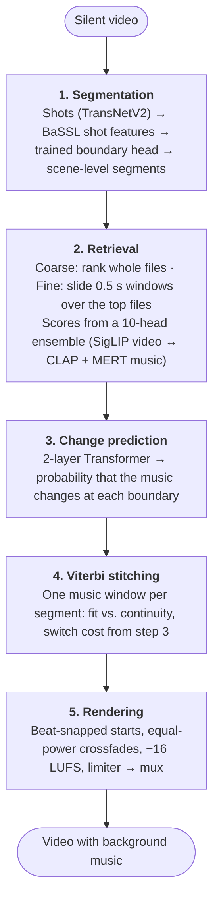

# Sequence-Level Background Music Retrieval for Audio-Independent Video

**Pradeep S S**


---

## Contents

1. [Abstract](#1-abstract)
2. [Introduction](#2-introduction)
3. [Problem statement](#3-problem-statement)
4. [Objectives](#4-objectives)
5. [Dataset](#5-dataset)
6. [Methodology](#6-methodology)
7. [Evaluation setup](#7-evaluation-setup)
8. [Results](#8-results)
9. [Key findings](#9-key-findings)
10. [Limitations](#10-limitations)
11. [Future work](#11-future-work)
12. [Future work (technical)](#12-future-work-technical)
13. [Technology stack](#13-technology-stack)
14. [Repository guide](#14-repository-guide)
15. [Glossary](#15-glossary)

---

## 1. Abstract

Background music (BGM) shapes how a viewer feels about a scene, but picking it by hand takes time and skill. Earlier
video-to-music retrieval work matches **one clip to one piece of music**. A real soundtrack is a **sequence**: it has to
decide when to keep a track playing and when to switch to a new one.

This project builds a system that takes a silent video and returns a full soundtrack. The video is cut into
scene-level segments with TransNetV2 shot detection and a BaSSL-based scene-boundary model. Candidate music windows are
retrieved for each segment with a 10-model ensemble of light projection heads on top of frozen foundation encoders:
SigLIP for video, CLAP + MERT for music. A small Transformer predicts how likely the music is to change at each segment
boundary, and a **Viterbi** pass picks one music window per segment, trading off how well the music fits each scene
against keeping the music continuous. The soundtrack is then rendered with beat-snapped starts, equal-power crossfades
and loudness normalisation.

On a **leak-free, film-title-level split** of a 1,011-pair Indian film dataset, the system finds the correct song in its
top 10 for **30.1%** of test videos (chance 6.9%). That is about **3× every published baseline and zero-shot model
tested**, whose best is 11.3%. On test videos built from clips of different songs, Viterbi stitching places music
changes better than greedy per-segment choice. The project also states plainly what does **not** work: beat-level sync,
in-clip music changes and scene-driven change prediction are at or near chance on this data.

---

## 2. Introduction

Music is central to how films, short videos and advertisements land with an audience. Choosing background music means
answering two questions:

1. **What** should play? Its mood, energy and genre have to fit what is on screen.
2. **When** should it change? A good soundtrack holds a cue through a continuous scene and moves to a new one when the
   story moves on.

Most research on video-to-music retrieval answers only the first question, for one short clip at a time. That is enough
for a 15-second social-media clip, but not for a longer video with several scenes. Played back to back, independent
per-segment picks give a soundtrack that jumps from track to track every few seconds.

This project treats soundtrack creation as a **sequence problem**. It combines per-segment retrieval with sequence-level
decoding (Viterbi), so the system decides *what* and *when* together. The video is treated as **audio-independent**:
every visual feature is read from a silent copy of the video, so the system never hears the original soundtrack.

---

## 3. Problem statement

**Given** a silent video *V* and a fixed library *L* of music files,
**produce** a continuous soundtrack made of excerpts (windows) from *L* such that:

- each part of the video gets music that **fits its visual content** (mood, setting, energy);
- the music **stays continuous** while the scene continues, avoiding needless track switches and jumps inside a track;
- the music **changes** where the video's content changes;
- the result **sounds clean**: no hard cuts, no loudness jumps, and audio in sync with the picture.

**Why this is hard:**

- **Cross-modal gap:** pictures and music have no shared vocabulary; the link between them is learned and subjective.
- **Small data:** only about 1,000 aligned video–music pairs, from about 200 films, are available.
- **Data leakage:** neighbouring scenes of one film look alike, so a careless split lets a model memorise films instead
  of learning video–music fit. An honest benchmark has to keep whole films out of training.
- **Sequence decisions:** choosing the best music for each segment independently does not give a coherent soundtrack.

---

## 4. Objectives

1. Build a retrieval model that ranks music files and windows by how well they fit a video segment.
2. Build a sequence decoder that turns per-segment candidates into one coherent soundtrack.
3. Predict where the music should change, and use that prediction inside the decoder.
4. Render a finished, listenable soundtrack and mux it onto the video.
5. Evaluate all of this on a **leak-free** split, against published baselines, with confidence intervals.

---

## 5. Dataset

| | Original | **Cleaned (final system)** |
|---|---:|---:|
| Video–music pairs | 1,248 | **1,011** |
| Total music | 6.7 h | 4.65 h |
| Distinct songs (track groups) | 1,150 | 912 |
| Film groups | 219 | 211 |
| Test clips (over 5 folds) | 982 | 894 |
| Share of seconds that are clear music | 69.5% | 82.6% |

- **Sources:** Indian film scenes from SunNXT, YouTube and compilations. Clips run 1–171 s, with a median of 13 s
  (cleaned).
- **Pairs:** each video's own soundtrack is its BGM, so music and picture are time-aligned.
- **Cleaning:** every pair was hand-trimmed to drop non-music audio, using a purpose-built pair-trimmer tool
  ([`tools/pair_trimmer.py`](tools/pair_trimmer.py)).
- **Song grouping:** reused songs are found by audio fingerprinting (Chromaprint) and embedding similarity, so one song
  never appears in both train and test.
- **Title-level split:** 5 folds grouped by **real movie title**, using 224 hand-checked links between uploads of the
  same film. The number of films that appear in more than one test fold dropped from 84 to 1.

---

## 6. Methodology

### 6.1 Pipeline at a glance



### 6.2 Segmentation

- **Shot detection:** shot cuts are detected with TransNetV2.
- **Scene boundaries:** each shot is described with BaSSL (Boundary-aware Self-Supervised Learning) shot features, and a
  small trained head scores every shot cut as a scene boundary or not. Shots between accepted boundaries form one
  segment.
- **Result:** segments are scene-level and average about 11.9 s, against about 6.6 s for the earlier rule-based
  segmenter.
- **Earlier baseline:** PySceneDetect shots merged while neighbouring SigLIP image embeddings stay similar
  (cosine ≥ 0.85, at most 20 s, shots under 2 s folded into the more similar neighbour). It is kept only as the
  comparison point in [Section 8.2](#82-scene-segmentation).

### 6.3 Features (frozen encoders)

All pretrained encoders stay **frozen**; their features are computed once and cached.

| Side | Encoder | Rate |
|---|---|---|
| Video (silent copy only) | SigLIP so400m image embeddings | 1 frame/s |
| Music | CLAP (`larger_clap_music_and_speech`) concatenated with MERT-v1-330M | 1 Hz |

### 6.4 Semantic heads and ensemble

- **Heads:** one small MLP per side (LayerNorm → 512 → GELU → Dropout → 256, L2-normalised) maps the video and music
  features into a shared space. The pair has about 1.65 M parameters in total.
- **Training:** symmetric InfoNCE with a learnable temperature, AdamW, frame dropout and music-span jitter, with early
  stopping on validation recall. Pairs that share a song are masked out of each other's negatives.
- **Ensemble:** 10 heads trained with different seeds, with their cosine scores averaged. This was the single most
  reliable improvement: +0.059 track R@10 over single heads.

### 6.5 Coarse-to-fine retrieval

1. **Coarse:** score every library file against the whole video and against each segment, and shortlist the top 10
   files from each.
2. **Fine:** for each segment, slide windows every 0.5 s over the shortlisted files and score each window with the
   ensemble. Each segment keeps its top 20 windows as candidates.

### 6.6 Music-change predictor

- **Input:** one token per segment: mean SigLIP embedding, log duration, and the mean and spread of motion.
- **Model:** token MLP → a 2-layer bidirectional Transformer → a boundary head that outputs $p_i$, the probability that
  the music changes between segment $i$ and segment $i+1$.
- **Training:** 60–180 s sequences built from training clips, with a label of 1 where the song changes.

### 6.7 Viterbi stitching

Each segment's candidates form a lattice, and Viterbi finds the cheapest path through it. The transition costs are:

| Move between segments | Cost |
|---|---|
| Continue in the same file (the next stretch of audio) | $-\alpha \log(1 - p_i)$ |
| Switch to another file | $-\alpha \log p_i + \mu \cdot (\text{key} + \text{tempo distance})$ |
| Jump to another point in the same file | $-\alpha \log p_i + \lambda_{\text{jump}}$ |

Each candidate's unary cost is its negated retrieval score. All weights are tuned per fold on validation data only.
With the predictor switched off, a fixed switch penalty is used instead.

### 6.8 Rendering

1. Consecutive segments that use contiguous audio from one file are grouped into a "piece".
2. Each piece's start is moved onto a beat (within ±2 s) to put the most video cuts on beats.
3. Pieces are joined with equal-power crossfades and gain ramps.
4. Each piece is normalised to −16 LUFS, and a limiter caps peaks at −1 dBFS.
5. The audio is muxed onto the video, with a measured A/V offset correction.

---

## 7. Evaluation setup

- **Protocol:** 5-fold title-level split; results are the mean over 5 folds × 3 seeds. Each "seed" of the final system
  is its own set of 10 heads.
- **No test leakage:** test folds are never used for training, early stopping, calibration, fusion weights or penalty
  tuning.
- **Statistics:** 95% confidence intervals come from a cluster bootstrap over **film groups** (10,000 resamples), so
  clips of one film are not counted as independent. Paired Wilcoxon tests use Holm correction.

| Metric | What it measures |
|---|---|
| Track R@k | Is any file of the correct song in the top *k* for a whole test video? |
| Pairwise accuracy | How often a video's own music scores above another song's music (chance 0.5). |
| Switch-boundary F1 (±1 s) | Do predicted music switches line up with true song changes? |
| In-film boundary F1 | The same, counted only at changes between clips of the same film (the hard case). |
| ImageBind / LanguageBind score | Video–music similarity measured by independent models the system never uses. |

**Baselines**, all scored by one shared evaluator on the same 894 test videos: ImageBind zero-shot, LanguageBind
zero-shot, MMTrail captions → CLAP, VM-NET, EmoMV (single-task and multi-task) and DecCM.

---

## 8. Results

### 8.1 Video → music retrieval

Cleaned title split, 894 test videos. Median rank: lower is better.

| Method | R@1 | R@5 | R@10 [95% CI] | Median rank ↓ | Pairwise acc. |
|---|---:|---:|---:|---:|---:|
| **This system (10-head ensemble)** | **0.052** | **0.190** | **0.301 [0.269, 0.338]** | **24.1** | **0.781** |
| LanguageBind zero-shot | 0.014 | 0.066 | 0.113 | 62.4 | 0.592 |
| ImageBind zero-shot | 0.012 | 0.054 | 0.110 | 62.5 | 0.601 |
| EmoMV, single-task | 0.007 | 0.053 | 0.103 | 65.9 | 0.577 |
| VM-NET | 0.011 | 0.047 | 0.092 | 71.7 | 0.558 |
| MMTrail captions → CLAP | 0.009 | 0.049 | 0.092 | 71.5 | 0.547 |
| DecCM | 0.010 | 0.040 | 0.075 | 78.6 | 0.527 |
| *Chance* | *0.007* | *0.035* | *0.069* | *90.0* | *0.500* |

- The system beats every baseline by +0.19 to +0.23 R@10, with every confidence interval clear of zero, and it leads in
  all 5 folds.
- The lead holds in both directions (music → video R@10 0.313) and when only the video's own music file counts as a hit.
- **Robustness:** with degraded test media (lower video resolution, MP3 compression), R@10 drops 6–17% for a single
  degradation and 29% for the worst combination, which is still about 2× ImageBind on clean media.
- **Speed (RTX 4080 SUPER):** a track query takes under 1 ms; a 5.8-minute video renders end to end in about 93 s.

### 8.2 Scene segmentation

Segmenters are scored on how well they find the 868 clip joins in the joined test sequences.

| Segmenter | AP | F1 | Mean segment length |
|---|---:|---:|---:|
| PySceneDetect + SigLIP merge (baseline) | – | 0.443 | 6.6 s |
| **TransNetV2 + BaSSL + trained head (final)** | **0.729** | **0.679** | 11.9 s |

- The BaSSL-based segmenter improves boundary F1 by +0.236 over the rule-based baseline.
- Swapping only the shot detector (PySceneDetect → TransNetV2) adds nothing on its own; the gain comes from the BaSSL
  features and the trained head.
- On the 3,467 shot cuts *inside* continuous test clips (452 of them real music changes), every segmenter variant is at
  chance for predicting music changes (AUROC 0.52–0.54). The joins benchmark therefore measures scene change, not music
  change.

### 8.3 Sequence-level stitching

| Test | Viterbi | Greedy | Δ [95% CI] |
|---|---:|---:|---|
| Switch F1, concatenations of different songs (original data) | **0.730** | 0.602 | **+0.128 [+0.109, +0.148]** |
| Switch F1, concatenations (cleaned data) | – | – | +0.089 [+0.069, +0.109] |
| Blocked in-film sequences (cleaned data) | – | – | tie: greedy − Viterbi −0.007 [−0.022, +0.008] |

Viterbi also cuts the switch rate from 6.2 to 3.4 per minute (the true rate is 2.6), so the soundtrack sounds far less
choppy.

### 8.4 Music-change predictor

In-film boundary F1 on cleaned data.

| System | F1 |
|---|---:|
| Greedy (no Viterbi) | 0.538 |
| Fixed penalties, re-tuned | 0.581 |
| Cosine rule between neighbouring segments | 0.600 |
| **Learned predictor + Transformer (final system)** | **0.604** |
| *Oracle (true change points)* | *0.837* |

The learned predictor beats re-tuned fixed penalties by +0.023 [+0.004, +0.043]. However, most of that signal comes from
segment length (see [Limitations](#10-limitations)).

---

## 9. Key findings

1. **Strong frozen features plus a light ensemble work best on small data.** The system retrieves the right song about
   3× as often as every published system tested.
2. **The visual signal tells you what kind of music fits, not exactly where it lines up.** Song-level retrieval works;
   beat-level sync and the precise offset inside a song are at chance.
3. **The limit is the number of distinct films, not model capacity.** Train R@10 is about 0.87 against about 0.30 on
   test. Each doubling of training films adds about +0.054 R@10 with no plateau. Adding 2,998 clips from only 32 extra
   films added nothing.
4. **Sequence decoding matters when songs really change.** Viterbi beats greedy clearly on concatenations of different
   songs, but not on blocked in-film sequences.
5. **Cleaning the dataset did not improve retrieval** (−0.007 [−0.024, +0.010]), even though it made the audio more
   musical.
6. **Many ideas were tested honestly and dropped**: dynamics and mood branches, unlabeled pretraining, V-JEPA 2 video
   features, cross-attention, person/face branches, temporal tokens and alternative losses. None beat the simple design
   on the leak-free split.

---

## 10. Limitations

- **The architecture is not the main source of the gain.** Re-implemented on the *same* frozen features, published
  architectures (CFD, UT-CMVMR, MVPt) tie the heads. Most of the lead over published systems comes from the frozen
  foundation encoders and ensembling.
- **The change predictor mostly learns segment length.** In joined test sequences, short single-segment clips mark clip
  joins. With segment length held fixed, the predictor is near chance (AUROC about 0.55), and it ties a duration-only
  prior (+0.007 [−0.015, +0.029]). The Transformer adds nothing measurable over a simpler pair-only model.
- **No continuous films with annotated music changes.** All stitching tests use dataset clips joined end to end, so
  every true change is a clip join. Real music changes *inside* continuous footage could not be tested properly; on shot
  cuts inside continuous clips, the segmenter and change predictor are at chance (AUROC 0.52–0.54).
- **Viterbi's advantage depends on the test protocol.** It wins on concatenations of different songs and ties greedy on
  blocked in-film sequences.
- **No beat-level sync from the picture.** Render-time beat snapping aligns random music just as well, so it is
  post-processing, not learned.
- **Weak automatic judges.** ImageBind and LanguageBind similarity barely separate methods: the original music scores
  about the same as the system's picks.
- **No human listening study yet.** The kit is built ([`src/bgm/listening/`](src/bgm/listening/)) but has not been run.
- **Small, narrow dataset.** It holds about 1,000 pairs from about 210 film groups, all Indian films, so results may not
  carry over to other film cultures, genres or user-generated video.
- **Fixed library.** The system can only retrieve and arrange existing music; it does not compose new music.
- **Heavy setup.** It needs an NVIDIA GPU, and the full working data (datasets, features, runs) is about 270 GB. Only
  the code is in git.

---

## 11. Future work

- **More distinct films.** The learning curve has not plateaued, so this is the clearest path to better retrieval.
- **Annotated continuous films**, to measure and learn real scene-driven music changes instead of clip joins.
- **A human listening study**, to measure how good the soundtracks actually sound to people.
- **Better change cues**, such as audio-free story signals (dialogue structure, scene semantics), to close part of the
  +0.23 F1 gap to the oracle.
- **Generation or editing**: combining retrieval with music generation or re-arrangement, to fit cues to exact scene
  lengths.
- **Wider data**: other languages, genres and user-generated video.

---

## 12. Future work (technical)

- **Modality-specific loss functions.** The current system is trained with a single symmetric InfoNCE loss computed on
  the cosine similarity between the video and music embeddings. Future work could add a separate loss for each
  modality, for example an intra-modal contrastive loss that pulls together segments of the same video and windows of
  the same song, alongside the cross-modal loss, to improve the model's retrieval performance.
- **Hard-negative mining.** The model currently treats all other songs in a batch as equally negative. Selecting harder
  negatives, such as songs with a similar mood or tempo, could help the model learn finer differences between suitable
  and unsuitable music.
- **Re-ranking the retrieved candidates.** A second-stage re-ranker that looks at the shortlisted music windows together
  with the full video context could improve the top-ranked results without changing the first-stage retrieval model.

---

## 13. Technology stack

| Area | Tools |
|---|---|
| Language | Python 3.11 |
| Deep learning | PyTorch, Hugging Face Transformers |
| Encoders | SigLIP, CLAP, MERT (plus ImageBind, LanguageBind and PANNs for evaluation) |
| Segmentation | TransNetV2, BaSSL (PySceneDetect for the baseline) |
| Audio / video | ffmpeg, librosa, Chromaprint (`fpcalc`), pyloudnorm |
| CLI and config | Typer (`bgm ...` commands), OmegaConf YAML configs |
| Testing | pytest (about 500 tests, CPU-only with fake encoders) |
| Hardware used | NVIDIA RTX 4080, 16 GB |

---

## 14. Repository guide

| Path | What is there |
|---|---|
| [`README.md`](README.md) | Code structure of the final system: which files run, and what each does. |
| [`R.md`](R.md) | Install and usage guide. |
| [`src/bgm/`](src/bgm/) | The `bgm` package (data, features, training, retrieval, change predictor, rendering). |
| [`configs/`](configs/) | YAML configs; `best_semantic.yaml` is the final system. |
| [`results/`](results/) | Result tables. |
| [`stitching/`](stitching/) | Stitching-method ablation study. |
| [`exp_supp/`](exp_supp/) | Supplementary experiments. |
| [`Demo_Outputs/`](Demo_Outputs/) | 11 demo clips: original video, the system's output, the chosen music and a report for each. |
| [`docs/`](docs/) | Full methodology, build spec and the decision log (D1–D155). |

Every folder has its own `README.md`.

**Quick start** (after installing, see [`R.md`](R.md)):

```bash
bgm render --config configs/best_semantic.yaml \
           --video input.mp4 --out output.mp4 \
           --run runs/cleaned/pipeline_ens10/fold0/seed0
```

For deeper reading: [`docs/PROJECT_BRIEFING.md`](docs/PROJECT_BRIEFING.md) (all results),
[`docs/METHODOLOGY.md`](docs/METHODOLOGY.md) (full method), [`docs/PROGRESS.md`](docs/PROGRESS.md) (every design
decision).

---

## 15. Glossary

| Term | Meaning |
|---|---|
| **BGM** | Background music. |
| **Segment** | A scene-level stretch of video (one or more shots) between two detected scene boundaries. |
| **BaSSL** | Boundary-aware Self-Supervised Learning: a pretrained model for finding scene boundaries between shots. |
| **Window** | A stretch of a music file chosen for one segment. |
| **Track R@k** | Share of test videos whose correct song is in the top *k* results. |
| **Viterbi** | A dynamic-programming algorithm that finds the best sequence of choices through a lattice of candidates. |
| **Greedy** | Picking the best music for each segment independently, with no sequence reasoning. |
| **Switch F1** | How well predicted music switches match the true song changes (within ±1 s). |
| **Oracle** | The decoder given the true change points; an upper bound for any change predictor. |
| **Title split** | Cross-validation folds grouped by real movie title, so no film is in both train and test. |
| **InfoNCE** | A contrastive loss that pulls matching video–music pairs together and pushes others apart. |
| **Frozen encoder** | A pretrained model used only to extract features; its weights are not trained. |
