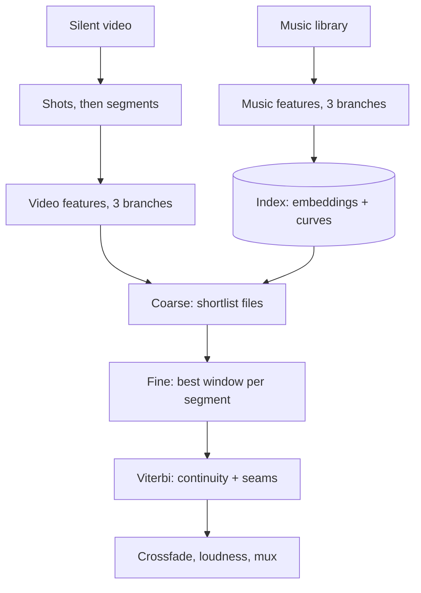

# SPEC — Video-to-BGM retrieval

This is the build spec for Claude Code. It stands alone: the settings, file formats and reference code below are enough to build the system. Work through §7 one milestone at a time, as `CLAUDE.md` describes.

Reference code marked **(tested)** was checked against brute force and synthetic signals before handoff. Port it as-is and keep equivalent tests.

## 0. What we are building

**Input:** a silent video. **Output:** the same video with a stitched background-music soundtrack drawn from a music library.

1. **Segment:** cut the video into shots, then merge shots into segments of 2–20 s.
2. **Featurize:** describe every segment and every music file with three branches:
   - **Semantic:** frozen image and music embeddings, plus small trained projection heads.
   - **Dynamics:** 25 Hz curves (motion, cuts, luminance vs onsets, beats, loudness), plus small trained temporal encoders.
   - **Attributes:** calibrated zero-shot mood distributions.
3. **Coarse retrieval:** shortlist music files on semantic and mood scores.
4. **Fine retrieval:** for each segment, find the best-synchronized window of each shortlisted file.
5. **Stitch:** choose one window per segment with a Viterbi pass that trades fit against continuity. Crossfade, normalize loudness, and mux onto the original video.

**Research hypotheses.** The evaluation must be able to answer each one.

| # | Hypothesis | Tested in |
| --- | --- | --- |
| H1 | Trained semantic heads beat ImageBind zero-shot on track R@10 | M6 |
| H2 | Learned dynamics beats hand-crafted dynamics on sync accuracy; shifted negatives are necessary | M7 |
| H3 | Fusing branches beats the best single branch on pipeline accuracy; coarse-to-fine matches single-stage pipeline accuracy | M9 |
| H4 | Self-supervised pretraining on unlabeled Indian clips beats training on the 1,255 pairs alone | M8 |
| H5 | Viterbi stitching beats greedy per-segment choice on concatenation accuracy, seams and listener preference | M10, M12 |

## 1. Open questions: ask the user at the start of M1

1. How are the pairs stored?
   - A video file plus a separate music file?
   - Videos with the music embedded in their audio track?
   - Something else? Show the user what you found in `data/raw/`.
2. Is there metadata, such as song title, film or album, language, or source URL? Where is it?
3. Is each pair's music time-aligned with its video, i.e. the BGM as it originally played? If the user doesn't know, M4 measures it.
4. How long are the clips typically, and at most? Are the music files full songs or excerpts the same length as the videos?
5. What hardware is available: GPU model, VRAM and free disk space?
6. Is the CFD paper and its code available? It's needed for M11.
7. For M8: which sources of unlabeled video are allowed? Never collect web data without explicit approval.

## 2. Pipeline



## 3. Data and splits

### 3.1 Manifest: `data/manifests/pairs.csv`

| Column | Meaning |
| --- | --- |
| `pair_id` | Stable unique string, e.g. the video file stem |
| `video_path` | Path under `data/raw/` |
| `music_path` | Path under `data/raw/`; empty when the music is embedded in the video |
| `music_source` | `file` or `embedded` |
| `music_id` | ID of the music file in the library; equals `pair_id` unless several pairs share one file |
| `video_duration_s`, `music_duration_s` | From ffprobe |
| `video_start_s`, `audio_start_s` | ffprobe `start_time` of the video stream and of the video's own audio stream (empty if it has none) |
| `fps`, `width`, `height`, `video_has_audio` | From ffprobe |
| `music_sr`, `music_channels` | From ffprobe |
| `meta_*` | Any metadata columns, copied as-is |
| `track_id` | Song group, filled by §3.2 |

### 3.2 Track grouping: `data/manifests/tracks.csv`

Reused songs must never span train and test. Group music files into `track_id`s:

1. **Metadata first.** If song identity is available, normalize titles (lowercase; strip punctuation and tags like "(Official Video)") and group equal titles within the same film or album.
2. **Chromaprint.** Run `fpcalc -raw -length 0 <file>` to get about 8 sub-fingerprints (32-bit ints) per second.
   - Find candidate pairs with an inverted index over sub-fingerprint values.
   - Verify each candidate by bit error rate at the best offset over at least 10 s of overlap. Link the pair if the rate is ≤ 0.35.
   - 0.35 is a starting value: tune it by listening to 10 flagged pairs just above and below it.
3. **Embeddings, after M3.** List pairs whose CLAP file-mean embeddings have cosine ≥ 0.90. These are the same song in a different excerpt, or a cover. The user confirms each link.
4. **Union-find** over the confirmed links. Columns: `track_id`, `music_ids` (semicolon-separated), `evidence` (`metadata` | `fingerprint` | `embedding-confirmed`).

### 3.3 Splits: `data/manifests/folds.json`

- Use `StratifiedGroupKFold(n_splits=5, shuffle=True, random_state=0)` over pairs, with `groups=track_id` and `y` = duration quartile.
- For fold k: `test` is fold k. Split the rest with `GroupShuffleSplit(n_splits=1, test_size=0.1, random_state=k)`, grouped by `track_id`, into `train` and `val`.
- Schema: `{"folds": {"0": {"train": [...], "val": [...], "test": [...]}, ...}, "manifest_hash": "...", "created": "..."}`.
- Freeze the folds after the M3 near-duplicate review. If track groups change later, regenerate the folds and rerun everything downstream. Log it in `docs/PROGRESS.md`.
- Models for new videos (deployment, §5.7) train on all pairs. Research numbers only ever come from the folds.

### 3.4 Media prep: `data/interim/`

- **Silent video:** `video/<pair_id>.mp4`.
  - Constant 25 fps (ffmpeg `fps=25` filter), audio stripped (`-an`).
  - Short side scaled to 480 px, H.264 CRF 18.
  - Frame 0 is the first video frame. Keep the original file for the final mux.
- **Music:** `music/<music_id>.flac`, mono, 48 kHz. Resample in memory to each encoder's rate, and assert the rate.
- **A/V alignment:** sample 0 of the music must be the instant of the first video frame.
  - For embedded audio, `offset = audio_start_s − video_start_s`. If it is positive, prepend that much silence; if negative, trim |offset| from the start.
  - For separate music files, assume sample 0 aligns with the first video frame. M4 tests this.
- **Checks:**
  - Report pairs whose video and music durations differ by more than 0.5 s.
  - Report every file that fails. Never silently skip one.

### 3.5 Shots, segments and windows

- **Shots:** PySceneDetect `AdaptiveDetector` by default, or TransNet V2 (`shots.detector`). Store cut times in `data/manifests/shots.csv` (`pair_id`, space-separated `cut_times_s`, on the interim timeline).
- **Segments:**
  - Merge consecutive shots greedily. A segment's embedding is the mean of its SigLIP 1 Hz vectors; use the nearest vector if a shot spans none.
  - Absorb the next shot while cosine ≥ `segments.merge_cosine` (0.85) and the length stays ≤ `segments.max_len_s` (20).
  - Then fold shots shorter than `segments.min_shot_s` (2 s) into the more similar neighbour. A clip under 2 s is one segment.
  - Write `data/manifests/segments.csv` with columns `pair_id`, `seg_idx`, `start_s`, `end_s`, `n_shots`.
- **Semantic span rule** (one rule everywhere: training, evaluation, retrieval): the semantic and attribute branches pool a span of at least `segments.min_music_span_s` (5 s). Shorter spans widen symmetrically, clamped to the file. This applies on both the video and the music side. The dynamics branch always uses the exact span.
- **Semantic positive:** the paired music over the segment's span, after the span rule.
- **Dynamics training windows:** these ignore segments.
  - Windows are a fixed `train.dynamics.window_s` (8 s = 200 steps), with starts uniform in [margin, duration − margin − 8]. The margin is `edge_margin_s`, 1.25 s, so every kept step has real context (§5.6).
  - Draw one window per 10 s of clip per epoch, and at least one.
  - Clips too short for a window are skipped for dynamics training; log the count. If more than 10% are skipped, add length buckets of 4 s and 6 s, batched by length.

### 3.6 Unlabeled pretraining set (M8 only, with approval)

- **Target:** 5,000–20,000 clips of 10–30 s where music drives the edit: film song videos, dance covers, event montages, reels and ads. HIMV-200K and MGSV-EC are public options; check their release terms.
- **Speech filter:** tag 1 s frames with PANNs CNN14 (`panns_inference`, **32 kHz** input).
  - Keep frames with Music ≥ 0.5 and Speech < 0.3; these are starting thresholds, tuned on 30 hand-checked clips.
  - Keep clips with ≥ 8 s of continuous kept frames.
- **Why not Demucs:** it splits vocals from accompaniment, so it would strip singing along with speech.
- **Dedupe:** match against all 1,255 pairs with Chromaprint and CLAP (cosine ≥ 0.90), and drop any match.
- **A/V alignment:** as in §3.4.

## 4. Interfaces

### 4.1 Manifests

`pairs.csv`, `tracks.csv`, `folds.json`, `shots.csv` and `segments.csv` are as in §3. Always read them through `bgm.data.manifest`, never ad hoc.

### 4.2 Feature files

Timing conventions:

- `T1 = floor(duration_s)`. The 1 Hz sample k is centred at k + 0.5 s.
- `T25 = round(25 × duration_s)`. The 25 Hz sample t sits at t / 25 s.
- To map 1 Hz to 25 Hz, use `upsample_1hz_to_25hz` (§5.2). A plain `np.interp` over `arange(T1)` is 0.5 s late.
- Curves are stored raw; normalization happens at load time (§5.2).
- Mood and occasion scores are stored as raw logits; calibration happens at load time (§5.3).

**Video: `data/features/video/<pair_id>.npz`**

| Key | dtype | Shape | Notes |
| --- | --- | --- | --- |
| `sem_siglip_1hz` | float16 | [T1, 1152] | SigLIP image embeddings, L2-normalized |
| `sem_clip_1hz` | float16 | [T1, 768] | Optional: CLIP ViT-L/14 check, L2-normalized |
| `attr_logits_1hz` | float32 | [T1, M] | Raw mood logits (M = number of mood words) |
| `bridge_logits_1hz` | float32 | [T1, O] | Raw occasion logits (text-bridge baseline) |
| `imagebind_1hz` | float16 | [T1, 1024] | Baseline only, L2-normalized |
| `dyn_25hz` | float32 | [T25, 5] | `log_motion`, `visual_onset`, `cut_impulse`, `luma_change`, `camera_motion` |
| `cut_times_s` | float32 | [n_cuts] | Copied from `shots.csv` |
| `meta` | str | JSON | Config hash, extractor versions, fps, duration |

**Music: `data/features/music/<music_id>.npz`**

| Key | dtype | Shape | Notes |
| --- | --- | --- | --- |
| `sem_clap_1hz` | float16 | [T1, 512] | 10 s window centred on each second, L2-normalized |
| `sem_mert_1hz` | float16 | [T1, 1024] | Layer-normalized mean over MERT's 25 hidden states, L2-normalized (§5.1) |
| `sem_mert_layers_1hz` | float16 | [25, T1, 1024] | Only when `store_all_mert_layers` (off by default; about 51 KB per second of audio) |
| `attr_logits_1hz` | float32 | [T1, M] | Raw mood logits |
| `bridge_logits_1hz` | float32 | [T1, O] | Raw occasion logits |
| `imagebind_1hz` | float16 | [T1, 1024] | Baseline only; 2 s windows centred on each second |
| `dyn_25hz` | float32 | [T25, 5] | `log_onset`, `beat_impulse`, `rms_db`, `centroid_change`, `novelty` |
| `beat_times_s` | float32 | [n_beats] | |
| `tempo_bpm` | float32 | scalar | ≤ 0 when unknown |
| `key_pc`, `key_mode`, `tonic_pc` | int8 | scalar | Pitch class 0–11; mode 0 = major, 1 = minor; −1 when unknown |
| `meta` | str | JSON | As for video |

### 4.3 Models

```python
class SemanticHead(nn.Module): ...      # [B, d_in] -> [B, 256], unit norm
class DynamicsEncoder(nn.Module): ...   # [B, 5, T] -> [B, T, 64], unit norm per step
class AttributeMap(nn.Module): ...      # optional: [B, M] calibrated log-probs -> [B, M] logits, init identity
```

Full definitions are in §5.5.

### 4.4 Run outputs

- `runs/<exp>/fold<k>/seed<s>/` holds `config.yaml`, `metrics.json` (val and test), `ckpt.pt` (best on val), `train_log.csv`, `git_commit.txt` and `fusion.json` (weights and penalties tuned for this fold and seed).
- `runs/<exp>/all/seed<s>/` holds deployment models trained on all pairs (§5.7).
- `results/<exp>.csv` and `results/<exp>.md` hold the aggregated tables (mean ± std over folds × seeds).
- `reports/*.md` hold audits and diagnostics.

## 5. Components

### 5.1 Semantic features

- **Video:** SigLIP `google/siglip-so400m-patch14-384` via `AutoModel` / `AutoProcessor` and `get_image_features`.
  - Sample frames at k + 0.5 s from the silent interim video, and L2-normalize the embeddings.
  - Store CLIP `openai/clip-vit-large-patch14` as well when `features.sem_video.store_clip` is true.
- **Music, CLAP:** `laion/larger_clap_music` via `ClapModel` / `ClapProcessor` and `get_audio_features`, at 48 kHz.
  - For each second k, embed the window [k + 0.5 − 5, k + 0.5 + 5] s, clipped to the file. Pass shorter windows as they are; the processor pads them.
  - L2-normalize the embeddings.
- **Music, MERT:** `m-a-p/MERT-v1-330M` (`trust_remote_code=True`) with its `Wav2Vec2FeatureExtractor`, at 24 kHz and `output_hidden_states=True`. The output is 25 layers × 75 Hz frames × 1024 dimensions.
  - Run 30 s chunks with up to 5 s of context on each side, and keep only each chunk's central frames.
  - Average the frames inside each second. L2-normalize each layer's vectors, average over the layers, then L2-normalize again. This stops the high-norm deep layers from dominating.
  - Learned layer weights are a later experiment, on the optional all-layer store.
- **`music_feature: both`:** concatenate the L2-normalized CLAP and MERT vectors, which are unit norm each.
- **Optional music feature:** the user's raga-recognition model embedding, as an extra music-side semantic input. It is an ablation in M11.

### 5.2 Dynamics features (25 Hz)

**Video channels**, computed from the silent 25 fps interim video after converting frames to grayscale with the short side at 256 px:

| Channel | Definition |
| --- | --- |
| `log_motion` | log(1 + mean optical-flow magnitude, in px/frame). Farnebäck: `pyr_scale=0.5, levels=3, winsize=15, iterations=3, poly_n=5, poly_sigma=1.2`. Or RAFT-small from torchvision (H and W must be divisible by 8). |
| `visual_onset` | max(0, log_motion[t] − log_motion[t−1]), computed after the cut masking below |
| `cut_impulse` | Sum of Gaussians (σ = 0.04 s, peak 1) at the cut times |
| `luma_change` | abs(mean luma[t] − mean luma[t−1]) / 255 |
| `camera_motion` | Mean magnitude, over a 16 × 16 grid, of the displacement predicted by `cv2.estimateAffinePartial2D` (RANSAC) fitted to the flow at those points, in px/frame |

- Flow across a hard cut is meaningless. At each cut frame and the frame after it, replace `log_motion` and `camera_motion` with the median of the 5 frames on each side. Then compute `visual_onset`.
- The first frame's difference channels are 0.

**Music channels**, computed with librosa at `sr=22050` and the default hop of 512, then linearly interpolated onto t / 25 s:

| Channel | Definition |
| --- | --- |
| `log_onset` | log(1 + `librosa.onset.onset_strength`) |
| `beat_impulse` | Gaussians (σ = 0.04 s, peak 1) at the beats from `librosa.beat.beat_track(onset_envelope=..., units="time")` |
| `rms_db` | `librosa.amplitude_to_db(librosa.feature.rms(...))` |
| `centroid_change` | abs(Δ log(max(spectral centroid, 20 Hz))); the floor avoids log(0) in digital silence |
| `novelty` | Foote novelty on the cosine self-similarity of `sem_mert_1hz`, with a Gaussian-tapered checkerboard kernel of half-width 8 s, mapped to 25 Hz with `upsample_1hz_to_25hz` |

**Normalization at load time:**

- z-score the continuous channels over the whole file: (x − mean) / (std + 1e-6). These are `log_motion`, `visual_onset`, `luma_change`, `camera_motion`, `log_onset`, `rms_db`, `centroid_change` and `novelty`.
- Leave `cut_impulse` and `beat_impulse` as they are, in [0, 1]. z-scoring a sparse impulse train makes its peak height depend on how many events there are.
- Never z-score per window; that erases the energy difference between calm and intense segments.

```python
def upsample_1hz_to_25hz(x, n25):
    """(tested) x: [T1] or [T1, C] with sample k centred at k + 0.5 s -> [n25(, C)] at t / 25 s."""
    t = np.arange(n25) / 25.0
    src = np.arange(len(x)) + 0.5
    if x.ndim == 1:
        return np.interp(t, src, x)
    return np.stack([np.interp(t, src, x[:, c]) for c in range(x.shape[1])], axis=1)
```

### 5.3 Attributes and text bridge

- **Moods:** the word list and templates in `features.attributes` (§6).
  - For each word, average the L2-normalized text embeddings over its templates, then renormalize.
  - SigLIP text inputs must use `padding="max_length"`, matching how SigLIP was trained.
- **Stored logits:**
  - SigLIP: `logit_scale.exp() * cos + logit_bias`.
  - CLAP: `logit_scale_a.exp() * cos`.

  These are computed per 1 Hz sample on both sides.
- **Calibration at load time** (train split only; the two models have unrelated scales and word priors):
  1. For each side and each word, z-score the logits using that word's mean and std over the train split's 1 Hz samples.
  2. Softmax over the words with one temperature per side. Pick it from `features.attributes.temps` on train pairs by maximizing the mean `s_attr` of true pairs minus shuffled pairs.
- **Score:** `s_attr = 1 − JSD₂(p_v, p_m)`, where JSD₂ is the Jensen–Shannon divergence in bits. In SciPy that is `1 - jensenshannon(p, q, base=2) ** 2`, because `jensenshannon` returns the square root of the divergence.
- **Text bridge (a baseline only):** the same procedure over `features.bridge`, giving `bridge_logits_1hz`.

### 5.4 Per-track extras

- Tempo and beats from librosa (§5.2). Check beats by ear on 20 tracks: tala-based songs can fool Western-trained beat trackers. Record what you find in `docs/PROGRESS.md`.
- **Key and mode:** Essentia `KeyExtractor`. Fallback: Krumhansl–Kessler profile correlation on mean `chroma_cqt`.
- **Tonic:** Essentia `TonicIndianArtMusic`, when `features.tonic` is true.
- Stitching compares pitch classes on the circle of fifths:

```python
def stitch_key(key_pc, key_mode, tonic_pc, use_tonic):
    """(tested) Pitch class compared across tracks: the tonic when use_tonic, else the relative-major
    key (minor -> +3 semitones). -1 when unknown. Never compare a tonic with a key."""
    if use_tonic:
        return tonic_pc
    if key_pc < 0:
        return -1
    return (key_pc + 3) % 12 if key_mode == 1 else key_pc


def fifths_distance(a, b):
    """(tested) 0 = same, 1/6 = a fifth apart (C-G, C-F), 1 = tritone; 0.5 if either is unknown."""
    if a < 0 or b < 0:
        return 0.5
    d = abs((7 * a) % 12 - (7 * b) % 12)
    return min(d, 12 - d) / 6.0
```

### 5.5 Models

```python
import torch, torch.nn as nn, torch.nn.functional as F

class SemanticHead(nn.Module):
    """[B, d_in] -> [B, d_out], unit norm."""
    def __init__(self, d_in: int, hidden: int = 512, d_out: int = 256, p: float = 0.2):
        super().__init__()
        self.net = nn.Sequential(nn.LayerNorm(d_in), nn.Linear(d_in, hidden), nn.GELU(),
                                 nn.Dropout(p), nn.Linear(hidden, d_out))

    def forward(self, x):
        return F.normalize(self.net(x), dim=-1)


class ResBlock(nn.Module):
    def __init__(self, ch: int, k: int, dilation: int):
        super().__init__()
        self.conv = nn.Conv1d(ch, ch, k, dilation=dilation, padding=dilation * (k - 1) // 2)
        self.norm = nn.GroupNorm(1, ch)

    def forward(self, x):                                # [B, ch, T] -> [B, ch, T]
        return x + F.gelu(self.norm(self.conv(x)))


class DynamicsEncoder(nn.Module):
    """[B, c_in, T] -> [B, T, ch], unit norm per step. Receptive field 61 steps (2.44 s at 25 Hz),
    about 87K parameters. One instance for video curves, a separate one for music curves."""
    def __init__(self, c_in: int = 5, ch: int = 64, k: int = 5, dilations=(1, 2, 4, 8)):
        super().__init__()
        self.inp = nn.Conv1d(c_in, ch, 1)
        self.blocks = nn.Sequential(*[ResBlock(ch, k, d) for d in dilations])
        self.out = nn.Conv1d(ch, ch, 1)

    def forward(self, x):
        h = self.out(self.blocks(self.inp(x)))
        return F.normalize(h.transpose(1, 2), dim=-1)
```

**Optional `AttributeMap`:** `nn.Linear(M, M)` on calibrated log mood probabilities, initialized to the identity and trained with InfoNCE. Keep it only if M11's ablation shows a gain.

### 5.6 Losses, negatives and encoding context

**Semantic:** symmetric InfoNCE with a learnable temperature τ (start 0.07, floor 0.01).

```
L_sem = -(1/2B) Σ_i [ log softmax_j(s_ij / τ)[i] + log softmax_j(s_ji / τ)[i] ],   s_ij = cos(g_v(v_i), g_m(m_j))
```

A batch holds one segment per video, and pairs sharing a `track_id` are masked out of the negatives.

**Dynamics:** equal-length video and music windows score by their mean per-step cosine:

```
s_dyn(x_v, x_m) = (1/T) Σ_t cos(h_v[t], h_m[t])
```

The negatives for each item are:

- the other music windows in the batch, with same-track ones masked;
- up to K = 4 shifted copies of its own music, from `sample_negative_shifts`.

**Encoding context: train the way you retrieve.** At retrieval (§5.9), each whole video and each whole music file is encoded once, and segments or windows are sliced from the result. Training must match this, so no kept step ever sees padding that retrieval wouldn't see:

- **Video:** encode the curves over [start − C, start + T + C], with C = `context_steps` = 30 (half the receptive field), clamped to the clip. Crop the aligned T steps.
- **Music:** encode once over [start − 4 s − C, start + T + 4 s + C], clamped to the file. Slice the aligned window and every shifted window from that one encoding.
- Shifts that don't fit set `shift_valid` to False.

```python
import numpy as np, torch, torch.nn.functional as F

def info_nce(zv, zm, track_ids, log_tau):
    """Symmetric InfoNCE. zv, zm: [B, D], L2-normalised; track_ids: LongTensor [B];
    log_tau: learnable scalar, start log(0.07). Same-track pairs are removed from the negatives."""
    tau = log_tau.exp().clamp(min=0.01)
    logits = zv @ zm.T / tau
    same = track_ids[:, None] == track_ids[None, :]
    eye = torch.eye(len(zv), dtype=torch.bool, device=zv.device)
    logits = logits.masked_fill(same & ~eye, float("-inf"))
    y = torch.arange(len(zv), device=zv.device)
    return 0.5 * (F.cross_entropy(logits, y) + F.cross_entropy(logits.T, y))


def dynamics_loss(hv, hm, hm_shift, shift_valid, track_ids, log_tau):
    """hv, hm: [B, T, D] per-step unit vectors of aligned video / music windows (cropped from context).
    hm_shift: [B, K, T, D] shifted music windows sliced from the same music encoding;
    shift_valid: [B, K] bool. track_ids: LongTensor [B]. (Index logic checked against a loop.)"""
    tau = log_tau.exp().clamp(min=0.01)
    T = hv.shape[1]
    s_batch = torch.einsum("btd,ctd->bc", hv, hm) / T               # [B, B], positives on the diagonal
    same = track_ids[:, None] == track_ids[None, :]
    eye = torch.eye(len(hv), dtype=torch.bool, device=hv.device)
    s_batch = s_batch.masked_fill(same & ~eye, float("-inf"))
    s_shift = torch.einsum("btd,bktd->bk", hv, hm_shift) / T         # [B, K]
    s_shift = s_shift.masked_fill(~shift_valid, float("-inf"))
    logits = torch.cat([s_batch, s_shift], dim=1) / tau
    y = torch.arange(len(hv), device=hv.device)
    return F.cross_entropy(logits, y)


def sample_negative_shifts(onset, beats, start, T, rng, k=4, fps=25, min_s=0.5, max_s=4.0,
                           guard_s=0.1, max_ac=0.5, ctx=25, max_tries=200):
    """(tested) Start frames of k distinct shifted copies of the aligned music window [start, start + T),
    shifted min_s..max_s seconds either way, keeping only shifts at which the music no longer lines up
    with itself. Both guards must pass:
      1. beat grid: the window's own beats, shifted by d, must not land (median) within guard_s of a beat;
         skipped when fewer than 2 beats fall in the window;
      2. onset autocorrelation: the z-scored onset curve over the window +/- ctx frames, correlated with
         itself at lag d, must stay below max_ac. This catches tempo octave errors, drift and unknown tempo.
    onset: [frames] z-scored log_onset of the file; beats: [n] beat times (s) of the file;
    rng: np.random.Generator seeded per item, e.g. np.random.default_rng([seed, epoch, item_idx]).
    Returns a list of start frames; slice them from the long encoded music sequence."""
    n = len(onset)
    lo, hi = max(0, start - ctx), min(n, start + T + ctx)
    ref = onset[lo:hi]
    local = beats[(beats >= start / fps) & (beats <= (start + T) / fps)]
    out = []
    for _ in range(max_tries):
        d = int(round(rng.uniform(min_s, max_s) * fps)) * int(rng.choice([-1, 1]))
        s = start + d
        if s in out or s < 0 or s + T > n or lo + d < 0 or hi + d > n:
            continue
        if len(local) >= 2:
            near = np.min(np.abs((local + d / fps)[:, None] - beats[None, :]), axis=1)
            if np.median(near) < guard_s:
                continue
        with np.errstate(invalid="ignore", divide="ignore"):
            ac = np.corrcoef(ref, onset[lo + d:hi + d])[0, 1]
        if np.isfinite(ac) and ac < max_ac:
            out.append(s)
            if len(out) == k:
                break
    return out
```

**What the sampler guarantees, measured on synthetic beat trains from 70 to 180 BPM:**

- With a correct beat grid, every accepted shift is at least 0.10 s from a whole number of beats. Under tempo drift, no accepted shift lines up locally.
- With half-tempo beats or no beats, the autocorrelation guard alone keeps shifts at least 0.05–0.08 s away from true whole-beat shifts. This is a known residual risk at fast tempos; the M11 "no guard" ablation measures how much the guards matter.

**Seeding:** seed the generator per item, e.g. `np.random.default_rng([seed, epoch, item_idx])`. A default generator built once at import gives identical shift sequences in forked DataLoader workers.

### 5.7 Training

Encoders stay frozen throughout. Only the heads and the dynamics encoders learn, so each run takes minutes on one GPU.

| Stage | What learns | Data | Stop rule |
| --- | --- | --- | --- |
| 0. References | Nothing | Test folds | None |
| 1. Self-supervised pretraining (M8) | Semantic heads, dynamics encoders | Unlabeled clips; random 5–10 s aligned spans stand in for segments | Loss on a 5% held-out slice stops falling for 10 epochs |
| 2. Training on pairs (M6, M7) | Same modules, from scratch or from stage 1 | Train split of each fold | Validation metric flat for 20 epochs |
| 3. Fusion and stitching (M9, M10) | Branch weights, stitching penalties | Val split, and val concatenations (§5.12) | Grid search (§5.8, §5.10) |
| 4. Joint (optional) | All heads, losses summed | Train split | As stage 2 |

- **Validation metrics:**
  - Semantic heads: segment-level R@10 on the val split.
  - Dynamics encoders: **sync accuracy** on the val split (§5.12). The loss deliberately does not penalize whole-beat shifts, so strict accuracy is not the target.
- Also run stage 2 without stage 1; the difference is the pretraining ablation.

| Setting | Semantic heads | Dynamics encoders |
| --- | --- | --- |
| Optimizer | AdamW, weight decay 0.05 | AdamW, weight decay 0.01 |
| Learning rate, scratch / pretrain / fine-tune | 1e-3 / 1e-3 / 1e-4 | 1e-3 / 1e-3 / 3e-4 |
| Schedule | Cosine, 5% warmup | Cosine, 5% warmup |
| Batch | 256 pretraining; 128 on pairs, one segment per video | 128 windows, each with up to 4 shifted negatives |
| Input | Span mean of 1 Hz embeddings (§3.5 span rule) | 8 s windows = 200 steps, cropped from context |
| Temperature | Learnable, start 0.07, floor 0.01 | Learnable, start 0.1, floor 0.01 |
| Epochs | Up to 200, patience 20 | Up to 200, patience 20 |
| Augmentation | Drop 25% of the 1 Hz frames before pooling; jitter the music span ±1 s | Gain ×0.8–1.2 per continuous channel, Gaussian noise σ 0.05, zero one channel with p 0.2 |
| Seeds | 0, 1, 2 per fold | 0, 1, 2 per fold |

- Never time-shift dynamics inputs as augmentation.
- **Deployment models:** `bgm train semantic|dynamics --all` trains on all pairs. The epoch count is the median best epoch across the 5 folds, since there is no validation set. `bgm render` uses these by default; `--run <dir>` overrides.

### 5.8 Fusion

- For a query, standardize each branch's scores across its candidate set, then take a weighted sum:
  `S(q, c) = Σ_b w_b · (s_b(q, c) − μ_b(q)) / max(σ_b(q), 1e-3)`, with `w_b ≥ 0` and `Σ_b w_b = 1`.
- **Coarse weights** (`w_sem`, `w_attr`): chosen to maximize val track R@10.
- **Fine weights** (`w_sem`, `w_dyn`, `w_attr`): chosen to maximize val pipeline window accuracy@1 (§5.12). That metric scores exactly what the fine stage chooses among: windows of the shortlisted files.
- Search a grid with step 0.1: 11 combinations for two weights, 66 for three. Tune per fold and seed, and save to that run's `fusion.json`.

### 5.9 Retrieval

**Index (per library, cached per checkpoint).** For each music file, store:

- The pooled semantic vector: the head applied to the mean of `sem_*_1hz` over the file.
- The mean calibrated mood distribution.
- Cumulative sums of the 1 Hz arrays in **float64**, so any window mean costs O(1). float16 cumulative sums drift by several percent on long tracks.
- The dynamics encoder output for the whole file, `hm` of shape [T25, 64].

**Query side:** encode the whole video's curves once and slice each segment's `hv` from the result. Never encode a segment on its own.

**Coarse: shortlist.**

- Score every library file against the whole video and against each segment (semantic and mood).
- The shortlist is the union of the whole-video top K and each segment's top K (`retrieval.coarse_top_k` = 10). Multi-scene videos need tracks for every part.
- When `retrieval.coarse_best_window` is true, score each file by its best 20 s window instead of its mean.

**Fine.**

- For each segment of duration d, every shortlisted file offers windows starting at its beat times in [0, duration − d], plus 0.
- Score each window with all three branches:
  - Semantic: the head applied to the window mean, after the span rule.
  - Dynamics: `sliding_dyn_scores`, read at the window start.
  - Attributes: `s_attr` against the window's mean calibrated mood distribution.
- Standardize each branch over **this segment's full window set**, and keep those μ and σ; continuation windows (§5.10) reuse them. Fuse (§5.8), and keep the top `retrieval.fine_top_j` (20) windows.

```python
def sliding_dyn_scores(hv, hm):
    """(tested) hv: [T, D] per-step unit vectors of a video segment; hm: [L, D] of a whole music file, L >= T.
    Returns s[o] = mean_t <hv[t], hm[o + t]> for every 25 Hz offset o = 0 .. L - T."""
    T = len(hv)
    return sum(np.correlate(hm[:, d], hv[:, d], mode="valid") for d in range(hv.shape[1])) / T

# GPU equivalent in one call (conv1d is cross-correlation):
# s = F.conv1d(hm.T[None], hv.T[None]).squeeze() / hv.shape[0]
```

### 5.10 Stitching

**Candidates for segment i:**

- its top J windows;
- the contiguous continuation of every surviving candidate for segment i − 1: same file, offset + duration, when it fits. Score it with segment i's saved μ and σ.

Deduplicate on (file, offset rounded to 40 ms).

**Beam:** once a list exceeds `stitch.beam_factor` × J, keep the candidates with the lowest **accumulated** Viterbi cost after the forward step, and generate the next continuations from those. Pruning on unary cost would drop exactly the weak-but-continuous chains that single-track output needs.

**Costs:**

- Unary cost: −S_fine.
- Moves within a file are free only when the audio is contiguous (within `tol_s` = 40 ms). Any other move within a file is a jump, which is penalized and crossfaded.
- Switches between files add a clash term: circle-of-fifths distance plus a folded tempo ratio.
- Use large finite penalties, never ∞: `stitch.never` = 1000 plays the role of "never switch". `viterbi` asserts that the best path cost is finite.

**Tuning:** one penalty set, tuned per fold and seed on the **val concatenation set** (§5.12), with these grids:

- `lam_switch` ∈ {0.5, 1, 2, 4, 8, `never`}
- `lam_jump` ∈ {0.25, 0.5, 1, 2}
- `mu` ∈ {0, 0.5, 1}

The objective is duration-weighted part track accuracy plus switch-boundary F1. Concatenations contain both behaviours the stitcher needs: staying on one track within a part, and switching between parts. Tuning on natural clips alone would drive `lam_switch` to `never`.

```python
from dataclasses import dataclass

@dataclass(frozen=True)
class Candidate:
    music_id: str     # the music FILE (not the track_id song group)
    offset: float     # window start in the file, s
    dur: float        # segment duration, s
    key: int          # stitch_key(...) pitch class, -1 unknown
    tempo: float      # BPM, <= 0 unknown
    cost: float       # unary cost = -S_fine (this segment's z-statistics)


def transition_cost(a, b, lam_jump, lam_switch, mu, tol_s=0.04):
    """(tested) Cost of moving from candidate a (segment i) to b (segment i + 1)."""
    if a.music_id == b.music_id:
        return 0.0 if abs(b.offset - (a.offset + a.dur)) <= tol_s else lam_jump
    if a.tempo > 0 and b.tempo > 0:
        r = abs(np.log2(b.tempo / a.tempo))
        tempo_d = 2.0 * abs(r - round(r))          # 0 = same, double or half time; 1 = worst
    else:
        tempo_d = 0.5
    return lam_switch + mu * (fifths_distance(a.key, b.key) + tempo_d)


def viterbi(cands, **tc):
    """(tested) cands: list over segments of lists of Candidate. Returns one index per segment minimising
    sum(cost) + sum(transition_cost). tc: lam_jump, lam_switch, mu, tol_s (finite values only)."""
    D = np.array([c.cost for c in cands[0]], dtype=float)
    back = []
    for i in range(1, len(cands)):
        C = np.array([[transition_cost(a, b, **tc) for b in cands[i]] for a in cands[i - 1]])
        tot = D[:, None] + C                        # [J_prev, J_cur]
        back.append(tot.argmin(axis=0))
        D = tot.min(axis=0) + np.array([c.cost for c in cands[i]])
    assert np.isfinite(D.min()), "path cost is not finite: use large finite penalties, not inf"
    path = [int(D.argmin())]
    for b in reversed(back):
        path.append(int(b[path[-1]]))
    return path[::-1]


def add_continuations(prev, cur, dur, file_len, score_fn):
    """(tested) Add each previous candidate's contiguous continuation to the current list.
    file_len: {music_id: seconds}; score_fn(music_id, offset, dur) -> unary cost using the SAME
    z-statistics as the current segment's other candidates."""
    seen = {(c.music_id, round(c.offset / 0.04)) for c in cur}
    out = list(cur)
    for a in prev:
        off = a.offset + a.dur
        key = (a.music_id, round(off / 0.04))
        if off + dur <= file_len[a.music_id] and key not in seen:
            seen.add(key)
            out.append(Candidate(a.music_id, off, dur, a.key, a.tempo, score_fn(a.music_id, off, dur)))
    return out
```

Pass the tuned penalties as `viterbi(cands, lam_jump=..., lam_switch=..., mu=..., tol_s=...)`. The config keys under `stitch` use these same names.

### 5.11 Rendering

1. **Runs:** group consecutive segments into maximal contiguous stretches of one file. These are the units of rendering.
2. **Build** the soundtrack at 48 kHz to the **original** video stream's duration (ffprobe), not the interim one.
3. **Crossfade** between runs, i.e. at every jump or switch, whenever the audio is not contiguous to the sample. Use an equal-power crossfade (`cos` / `sin` gains; constant power, tested).
   - Length: 4 beats at the incoming tempo, clamped to [1, 2] s, centred on the boundary.
   - Shorten it when there isn't enough audio before or after.
4. **Loudness:** normalize each run to `render.target_lufs` (−16) with pyloudnorm.
   - Runs shorter than 3 s use their file's overall integrated loudness.
   - Cap the gain at ±12 dB. pyloudnorm returns −inf for near-silence and rejects audio shorter than 0.4 s.
   - Fade out over min(2 s, 10% of the duration).
   - Finish with a lookahead limiter at −1 dBFS (e.g. `pedalboard.Limiter`), not plain peak normalization.
5. **Mux** onto the original video: `ffmpeg -i video.mp4 -itsoffset <video_start_s> -i bgm.wav -map 0:v:0 -map 1:a:0 -c:v copy -c:a aac -b:a 192k -shortest out.mp4`.
   - Then assert with ffprobe that the two stream start times differ by less than 1 ms.
   - `-map 0:v:0` avoids attached cover art.

Time-stretching is out of scope. Revisit it only if listeners flag tempo clashes at seams.

### 5.12 Evaluation

**Metrics**

| Metric | Definition |
| --- | --- |
| Track R@1/5/10, median rank, MRR | Query: a test video, pooled over the whole clip. Gallery: the test fold's music files, and separately all library music files. A hit is any file with the query's `track_id`. Chance is **exact per query**: `1 − C(N−h, k) / C(N, k)`, where h is the number of relevant files. |
| Segment R@1/5/10 | Query: a test segment of duration d. Gallery: for every test-fold segment, the music window at its aligned start, cut to length d and shifted back if needed to fit the file. The query's own window is the hit. Windows of *other* videos with the same `track_id` are left out. Report two variants: all windows, and other-video windows only (plus the query's own). The span rule (§3.5) applies to the semantic and attribute terms. |
| Grounding: strict, sync, median error | Query: each test segment at its exact duration, with its own music file given. Score every 25 Hz offset of the whole file: dynamics alone in M7, fused in M9. The argmax is the prediction. **Strict:** \|err\| ≤ 0.5 s. **Sync:** the predicted window lines up with the true one, i.e. \|err\| ≤ 0.1 s, or `sample_negative_shifts`' guards would reject a shift of err. Report both, plus the median \|err\|. |
| Pipeline accuracy | Per test segment, after the coarse and fine stages and before Viterbi. **Track@1:** the top window's file has the right `track_id`. **Window@1:** same `music_id`, and the offset is within 0.5 s of the aligned one. **Window@J:** any of the top J qualifies. After Viterbi, report the same measures duration-weighted over each video. This is the H3 metric and the fine-weight objective. |
| Excess cut-on-beat rate | Share of video cuts (more than 0.5 s from either end) with a soundtrack beat within ±70 ms, **minus** the mean rate over 20 circular shifts of the same soundtrack (uniform over its duration). Get the rendered soundtrack's beats by mapping the chosen windows' `beat_times_s` through the render timeline; don't re-run the tracker on the mix. Report two versions. **All cuts** is what viewers experience. **Within-piece cuts** leaves out every cut where a new piece starts, because pieces start on a beat by construction; only this version is evidence of learned sync. Also score a **beat-snapped control**: random windows with the same piece boundaries and beat-snapped starts. Clips with no eligible cuts are excluded. Report it for ours, the control, the original soundtrack and each baseline. |
| Seams | Switches and jumps per minute, and the loudness jump at each seam: short-term loudness over 3 s before vs after, in LU. |
| Concatenation benchmark | Per fold, build 50 **val** and 50 **test** long videos by joining 3–4 clips of that split with different `track_id`s. Val sets are for tuning penalties (§5.10); test sets are for reporting. Report duration-weighted part track accuracy (the chosen window's track matches the part's own) and switch-boundary F1 (a switch within ±1 s of a true join counts as a hit). |

**Baselines**

| Baseline | How |
| --- | --- |
| Random | Exact chance per query (above); M5 checks a simulation against it |
| ImageBind zero-shot | Cosine between `imagebind_1hz` span means. The weights are for non-commercial research; if its pinned requirements clash, isolate it in a separate env. |
| Text bridge, zero-shot | Mean of `s_attr` over calibrated `attr` and `bridge` distributions |
| Semantic branch alone | M6 |
| Hand-crafted dynamics | z(cut-on-beat rate of the segment's **internal** cuts against the window's beats) + z(Pearson correlation of the z-scored 25 Hz `log_motion` and `rms_db`). Both are z-normalized per query over its candidate offsets. Use the correlation term alone when a segment has no internal cuts. |
| UT-CMVMR | Code is released, but its targets come from an internal tagger, so adapt it. Ask the user first. |
| CFD | Rerun it from the user's code if available; otherwise reimplement its paths on these features. Ask the user first. |

**Ablations:**

- Drop each branch.
- No pretraining.
- No shifted negatives.
- No sync guards (accept every shift ≥ 0.5 s).
- No coarse stage: score every window of every file.
- Greedy choice per segment instead of Viterbi.
- SigLIP vs CLIP.
- CLAP vs MERT vs both.
- With and without the raga-model embedding.
- With and without `AttributeMap`.

**Statistics:**

- Final tables: 5 folds × 3 seeds, mean ± std. Average each query's metric over seeds first.
- Use a **cluster bootstrap** with 10,000 resamples that resamples `track_id` groups, with their videos and segments nested inside. Queries within a group are correlated, so resampling single queries overstates certainty. Report the mean difference and its 95% CI for each system comparison.
- M4's alignment audit uses a Wilcoxon signed-rank test on per-pair excess rates.
- M12 uses a two-way bootstrap over raters and videos, or a mixed-effects logistic model with random effects for rater and video.

### 5.13 Checking a silent video (no reference)

A truly silent video has no correct answer, so R@k and grounding don't apply.

- `bgm render` saves `renders/<name>.plan.json`: the segments, the chosen `music_id` and offset per segment, the pieces, per-branch z-scores, the penalties, and the run directories used.
- `bgm check --plan renders/<name>.plan.json` writes `reports/check_<name>.md` and a timeline PNG.
- Every check below is compared against the **beat-snapped control** (§5.12): random library windows with the same piece boundaries and beat-snapped starts, 20 draws.

| Check | Measure | Good looks like |
| --- | --- | --- |
| Sync | Excess cut-on-beat rate on within-piece cuts (§5.12) | Above the control |
| Energy match | Spearman correlation between video motion energy and soundtrack loudness, both averaged over 2 s windows | Positive, and above the control |
| Switch placement | Share of switches that fall on the scene boundaries with the biggest content change (top quartile of adjacent-segment SigLIP distance); switches per minute | Most switches at scene changes |
| Seams | Loudness jump per seam in LU; fifths distance and tempo ratio at each switch | Median jump under 2 LU; few clashes |
| Independent content check | Per segment: ImageBind similarity between its frames and its chosen window, as a percentile among 200 random library windows of the same length. ImageBind never takes part in selection, so this check is not circular. | Median percentile well above 50 |
| Model agreement | Jaccard overlap of the chosen tracks across the 3 deployment seeds | High overlap; low overlap means an unreliable choice |

- The report also lists each segment's branch scores, to explain the choices. They come from the system's own models, so they are not evidence of quality.
- **The timeline PNG shows:** cuts, segment boundaries, pieces coloured by track, beats, and the energy curves of both sides.
- **Listening check:** the M12 kit works for silent videos too. Compare ours, the beat-snapped control and the best baseline.
- **During development:** prefer "fake-silent" videos. Strip the audio from held-out test videos, as the fold evaluation does, so every §5.12 metric applies.

## 6. Defaults

### 6.1 `configs/default.yaml`

Values marked "tune" in the text are starting points; record the tuned values in `docs/PROGRESS.md`.

```yaml
seed: 0
fold: 0

paths:
  raw: data/raw
  interim: data/interim
  features: data/features
  manifests: data/manifests
  unlabeled: data/unlabeled
  runs: runs
  results: results
  reports: reports
  renders: renders

media:
  video_fps: 25
  video_short_side: 480
  video_crf: 18
  music_sr: 48000
  max_duration_mismatch_s: 0.5

shots:
  detector: pyscenedetect        # pyscenedetect | transnetv2
  adaptive_threshold: 3.0

segments:
  merge_cosine: 0.85             # tune by eye on 20 videos
  max_len_s: 20.0
  min_shot_s: 2.0
  min_music_span_s: 5.0          # the span rule (§3.5)

features:
  device: cuda
  fp16: true
  sem_video:
    model: google/siglip-so400m-patch14-384
    store_clip: true
    clip_model: openai/clip-vit-large-patch14
    batch: 64
  sem_music:
    clap_model: laion/larger_clap_music
    clap_sr: 48000
    clap_window_s: 10.0
    mert_model: m-a-p/MERT-v1-330M
    mert_sr: 24000
    mert_chunk_s: 30.0
    mert_context_s: 5.0
    store_all_mert_layers: false # about 51 KB per second of audio when true
  dynamics:
    rate_hz: 25
    flow: farneback              # farneback | raft_small
    flow_short_side: 256
    impulse_sigma_s: 0.04
    librosa_sr: 22050
    centroid_floor_hz: 20.0
    novelty_half_width_s: 8.0
    affine_grid: 16
  attributes:
    moods: [calm, joyful, romantic, melancholic, tense, suspenseful, energetic, heroic,
            playful, devotional, festive, nostalgic, mysterious, triumphant, serene, dramatic]
    video_templates: ["a {} scene", "a {} moment in a film", "a video that feels {}"]
    music_templates: ["{} music", "a {} song", "{} Indian film background music"]
    temps: [0.1, 0.2, 0.5, 1.0, 2.0]   # per-side softmax temperature grid, fit on train
  bridge:
    occasions: [a wedding, a temple festival, a religious ritual, a classical dance performance,
                a folk dance, a fight scene, a chase scene, a romantic date, a family gathering,
                a cricket match, a road trip, a beach, the mountains, a city at night, village life,
                cooking, a street market, monsoon rain, a sunrise, a party, a college campus,
                a workout, a product advertisement, a travel vlog]
    video_templates: ["a photo of {}", "a scene of {}"]
    music_templates: ["music for {}", "background music for {}"]
  imagebind:
    enabled: true
    sr: 16000
    window_s: 2.0
  tonic: false

unlabeled:
  panns_sr: 32000
  music_min: 0.5                 # tune on 30 hand-checked clips
  speech_max: 0.3
  min_run_s: 8.0

splits:
  n_folds: 5
  val_fraction: 0.1
  seed: 0

train:
  seeds: [0, 1, 2]
  warmup_frac: 0.05
  num_workers: 4
  semantic:
    video_feature: sem_siglip_1hz
    music_feature: sem_clap_1hz  # sem_clap_1hz | sem_mert_1hz | both
    hidden: 512
    out_dim: 256
    dropout: 0.2
    lr_scratch: 1.0e-3
    lr_pretrain: 1.0e-3
    lr_finetune: 1.0e-4
    weight_decay: 0.05
    batch_pretrain: 256
    batch: 128
    tau_init: 0.07
    tau_min: 0.01
    max_epochs: 200
    patience: 20
    frame_drop: 0.25
    music_jitter_s: 1.0
  dynamics:
    c_in: 5
    channels: 64
    kernel: 5
    dilations: [1, 2, 4, 8]
    context_steps: 30            # half the receptive field
    window_s: 8.0
    edge_margin_s: 1.25
    windows_per_10s: 1
    n_shift_neg: 4
    shift_min_s: 0.5
    shift_max_s: 4.0
    guard_s: 0.1                 # beat-grid guard
    max_ac: 0.5                  # onset-autocorrelation guard
    ac_ctx_steps: 25
    lr_scratch: 1.0e-3
    lr_pretrain: 1.0e-3
    lr_finetune: 3.0e-4
    weight_decay: 0.01
    batch: 128
    tau_init: 0.1
    tau_min: 0.01
    max_epochs: 200
    patience: 20
    gain_range: [0.8, 1.2]
    noise_sigma: 0.05
    channel_drop_p: 0.2

fusion:
  grid_step: 0.1
  sigma_floor: 1.0e-3

retrieval:
  coarse_top_k: 10
  coarse_best_window: false
  coarse_window_s: 20.0
  fine_top_j: 20

stitch:
  lam_jump: 1.0                  # tune on val concatenations (§5.10)
  lam_switch: 2.0                # tune
  mu: 0.5                        # tune
  tol_s: 0.04
  never: 1000.0                  # finite stand-in for "never switch"
  beam_factor: 5
  grid:
    lam_switch: [0.5, 1.0, 2.0, 4.0, 8.0, 1000.0]
    lam_jump: [0.25, 0.5, 1.0, 2.0]
    mu: [0.0, 0.5, 1.0]

render:
  sr: 48000
  crossfade_beats: 4
  crossfade_min_s: 1.0
  crossfade_max_s: 2.0
  target_lufs: -16.0
  min_run_for_loudness_s: 3.0
  gain_cap_db: 12.0
  fade_out_s: 2.0
  fade_out_max_frac: 0.1
  limiter_dbfs: -1.0

eval:
  ks: [1, 5, 10]
  grounding_tol_s: 0.5
  sync_tol_s: 0.1
  cut_beat_tol_s: 0.07
  circular_shift_draws: 20
  bootstrap_resamples: 10000
  bootstrap_cluster: track_id
  concat_videos_per_fold: 50
  concat_parts: [3, 4]
```

### 6.2 `environment.yml` (starting point; pin what works in `docs/PROGRESS.md`)

```yaml
name: bgm
channels: [conda-forge]
dependencies:
  - python=3.11
  - ffmpeg
  - pip
  - pip:
      - torch
      - torchvision
      - torchaudio
      - transformers>=4.40
      - sentencepiece
      - protobuf
      - accelerate
      - numpy
      - scipy
      - pandas
      - pyarrow
      - scikit-learn
      - librosa
      - soundfile
      - soxr
      - opencv-python-headless
      - scenedetect
      - pyloudnorm
      - pedalboard
      - panns-inference
      - typer
      - omegaconf
      - tqdm
      - pytest
      # optional: essentia (key/tonic; Linux and macOS wheels)
```

Chromaprint's `fpcalc` is a separate install: `sudo apt install libchromaprint-tools` on Ubuntu, or `brew install chromaprint` on macOS. `bgm doctor` checks that it is there.

## 7. Milestones

**Every milestone ends the same way:**

1. `pytest -q` is green.
2. `bgm smoke --fake` is green.
3. `docs/PROGRESS.md` is updated.
4. A commit is made.
5. A short report goes to the user. Then stop.

### M0: Skeleton, environment, fixtures

**Build**

- The files from §6: `pyproject.toml` (package `bgm`, script `bgm = "bgm.cli:app"`), `environment.yml`, `configs/default.yaml`, `.gitignore` (data/, runs/, results/, reports/, renders/), and `docs/PROGRESS.md`.
- The Typer CLI with every command in `CLAUDE.md` stubbed. Configs are loaded with OmegaConf, with dotted overrides.
- Encoder interfaces with deterministic fakes (random projections, fixed seed).
- **`tests/fixtures/synth.py`:** generates N synthetic pairs with a fixed seed, each 12–30 s at 25 fps and 320 × 240.
  - The music has a beat grid at a known tempo (70–180 BPM), with clicks on every beat.
  - Cuts fall on random beats 2–5 s apart. Each cut brings a new background colour and a moving square whose speed changes per shot.
  - At each cut, the music plays an accented click with a different timbre and changes its pad chord. The music at a cut is then distinct from a whole-beat shift of it, so grounding is identifiable.
  - The pad's pitch-class set follows the video's colour palette, so the semantic branch has something to learn.
  - Some fixtures have embedded audio that starts a known 0.12 s after the video. The M2 test uses them.
- **`bgm doctor`:** reports Python, torch, CUDA and GPU, and the versions of ffmpeg, ffprobe and fpcalc.

**Acceptance**

- `bgm --help` lists all commands.
- The fixture files are readable by ffprobe, and their durations match what was requested.
- `bgm doctor` output is pasted into `docs/PROGRESS.md`.

### M1: Audit, manifest, track groups, folds

**Build**

1. Ask the §1 questions (1–5).
2. Inspect `data/raw/`: a tree summary, the file extensions, and ffprobe on 5 samples. Propose a mapping to `pairs.csv` and wait for the user's OK.
3. **`bgm audit`:** writes `pairs.csv` and `reports/audit.md`. The report covers counts; min, median and max duration; the sets of fps and sample rates; stream start offsets; audio presence; duration mismatches over 0.5 s; and unreadable files.
4. Track grouping, steps 1–2 of §3.2, giving `tracks.csv`.
5. **`bgm folds`:** writes `folds.json`.

**Acceptance** (checked in `tests/test_splits.py` on synthetic manifests, then on the real one)

- Every pair is in exactly one test fold.
- No `track_id` appears in more than one fold's test set.
- Within each fold, train, val and test share no `track_id`.

**Report:** `reports/audit.md` and the fold sizes.

### M2: Media prep and shots

**Build**

- **`bgm prep` (§3.4):** parallel workers, resumable, with A/V offset correction. Failures go to `reports/prep_failures.md`.
- **`bgm shots` (§3.5):** writes `shots.csv`.
- **`bgm peek <pair_id>`:** writes a contact-sheet PNG of shot first frames with their times, for eyeballing detection.

**Acceptance**

- On the fixtures, detected cuts fall within ±1 frame of the true cuts, with precision and recall ≥ 0.95.
- On the offset fixtures, after prep, every accented click lies within ±1 frame of its cut.
- Interim videos have no audio stream (ffprobe).
- Interim durations match the originals within 0.1 s.

### M3: Features

**Build**

- The extractors in §5.1–5.4, behind `bgm extract --what sem_video,sem_music,dyn_video,dyn_music,attr,bridge,imagebind,key`.
  - Cache by config hash, and resume after a crash.
  - Log throughput.
- **`bgm check-features`:** validates shapes and dtypes against §4.2, looks for NaN or inf, checks unit norms on the L2-normalized embeddings, and checks the sample rates recorded in `meta`.
- Step 3 of §3.2: list near-duplicate candidates and ask the user to confirm them. Update `tracks.csv`, regenerate the folds if needed, then freeze them by recording the manifest hash.

**Acceptance** (on the fixtures)

- **Event timing:** place an event at a known time and check every channel's peak.
  - `cut_impulse` within ±1 frame.
  - `beat_impulse` within ±40 ms.
  - `visual_onset` at the speed-up.
  - Any 1 Hz-derived curve (e.g. `novelty`) mapped to 25 Hz at the right half-second.
- Tempo is within 2% of the truth; octave errors are flagged.
- No channel contains NaN or inf, including on a fixture with 2 s of digital silence.
- The video extractors never open an audio stream.

**Report:** extraction time per clip, any failures, and the near-duplicate decisions.

### M4: Segments and alignment audit

**Build**

- **`bgm segment` (§3.5):** writes `segments.csv`.
- **Alignment audit:** for each pair with internal cuts, compute the excess cut-on-beat rate (§5.12) of its own music. Write `reports/alignment.md` with:
  - the share of pairs with positive excess, and the Wilcoxon p-value;
  - histograms of segment length and segments per video.

**Acceptance**

- Segments tile each video exactly, with no gaps or overlaps (tested).
- The length rules hold, apart from documented edge cases.

**Stop and discuss.** If pairs are time-aligned, keep segment-level positives. If not, switch to track-level positives and learn dynamics from unlabeled data only (M8).

### M5: Evaluation harness and zero-shot references

**Build**

- `bgm.eval.metrics`: every metric in §5.12, with unit tests on hand-computed rankings, including the exact chance formula and the cluster bootstrap.
- The random, ImageBind, text-bridge and hand-crafted-dynamics baselines.
- The attribute calibration of §5.3, fit on train only.
- `bgm eval --exp zeroshot` over all 5 folds.

**Acceptance**

- A simulated random ranking matches the exact chance values within 2 std.
- `results/zeroshot.md` has the track, segment and grounding metrics.

### M6: Semantic heads

**Build**

- The segment dataset, plus a batch sampler that never puts two segments of one pair in a batch.
- `info_nce` with same-track masking; augmentations and early stopping as in §5.7.
- Runs over 5 folds × 3 seeds.
- Variants: SigLIP vs CLIP video features; CLAP vs MERT vs both for music.

**Acceptance**

- Tests for the sampler and for the loss masking.
- `results/semantic.md`, with cluster-bootstrap CIs against ImageBind.

**Decision:** if the heads don't beat ImageBind on mean track R@10 (H1), stop and report. M8 then moves up.

### M7: Dynamics encoders on pairs

**Build**

- The window dataset (§3.5), context encoding (§5.6), `sample_negative_shifts` with per-item seeding, `dynamics_loss`, and early stopping on val sync accuracy.
- Comparisons: learned vs hand-crafted dynamics, and learned with vs without shifted negatives (H2).

**Acceptance**

- On synthetic pairs, a trained encoder reaches sync accuracy ≥ 0.9 on val.
- A test shows that the per-step outputs of a context-cropped window equal the same slice of a whole-file encoding.
- `results/dynamics.md`: strict and sync grounding metrics.

**Skip** this milestone if M4 found the pairs not time-aligned.

### M8: Unlabeled pretraining (only after the user approves sources)

**Build**

1. Collect only the approved sources into `data/unlabeled/`, with a manifest.
2. Apply the speech filter and dedupe (§3.6).
3. Extract features with the same extractors.
4. Pretrain the semantic heads and dynamics encoders, then fine-tune per fold.

**Acceptance**

- The dedupe report shows 0 overlaps with the 1,255 pairs.
- `results/pretraining.md`: with vs without pretraining, with cluster-bootstrap CIs on track R@10 and sync accuracy (H4).

### M9: Fusion and coarse-to-fine retrieval

**Build**

- **`bgm fuse`:** grid search on val per fold and seed (§5.8).
- The retrieval module (§5.9) with an index cache, the union shortlist, and a single-stage variant.

**Acceptance**

- A unit test for per-query z-normalization, including the σ floor.
- `results/fusion.md`: pipeline accuracy and track R@10 for each branch alone, fused, and fused without the coarse stage (H3), with runtime per query.

### M10: Stitching, rendering, deployment models

**Build**

- Candidates, continuations, beam and Viterbi (§5.10).
- The val and test concatenation sets (§5.12).
- **`bgm tune-stitch`:** penalty tuning on the val concatenations.
- Rendering (§5.11).
- **`bgm train ... --all`:** the deployment models (§5.7).
- **`bgm render --video path --out path [--run dir]`:** also writes the plan JSON (§5.13).
- **`bgm check --plan path`:** the reference-free report for silent videos (§5.13).

**Acceptance**

- Viterbi matches brute force on small lattices.
- Transition-cost cases and the constant-power crossfade pass their tests.
- Output duration equals the original video's within 1 frame, and output loudness is −16 ± 1 LUFS on outputs of 10 s or more.
- Audio and video stream start times match within 1 ms.
- `results/stitching.md`: concatenation part accuracy, switch-boundary F1, seams per minute, seam loudness jumps, and excess cut-on-beat rate (all cuts and within-piece cuts), for Viterbi vs greedy vs the beat-snapped control vs the original soundtrack (H5).
- 10 renders are in `renders/`.
- `bgm check` runs on a synthetic silent video and on 3 of the renders. On the synthetic video, the within-piece sync beats the beat-snapped control.

**Stop:** the user watches the renders and approves the penalties.

### M11: Baselines, ablations, final tables

**Build**

- UT-CMVMR and CFD, after asking the user for the code or paper.
- The ablation grid (§5.12).
- **`bgm report --final`:** regenerates every table, as mean ± std with cluster-bootstrap CIs, from `runs/`.

**Acceptance:** `results/final.md` regenerates from one command.

### M12: Listening-study kit

**Build**

- Pick 20 test videos, stratified by duration and content. Include some test concatenations.
- Render four conditions: ours (Viterbi), greedy, the best baseline, and the original soundtrack. Anonymize the file names.
- The pairwise comparisons are ours vs greedy, ours vs baseline, and ours vs original. Give each rater a randomized order.
- Produce `ratings_template.csv` and `instructions.md`.
- Write an analysis script: win rates and 1–5 ratings (content, rhythm, mood, transitions), with a two-way bootstrap over raters and videos (§5.12).

**Acceptance:** a dry run with fake ratings produces the analysis report.

## 8. Pitfalls checklist

**Data and splits**

- **Leakage:** segments of one video, or one reused track, in both train and test. Split by video, grouped by `track_id`.
- **False negatives:** other segments of the same video used as negatives. Keep one segment per video per batch, and mask same-track pairs.
- **Soundtrack leakage at inference:** the query must be silent, so strip audio before computing any video feature.

**Timing**

- **A/V start offsets:** MP4 video and audio streams often start tens of ms apart, sometimes more than 100 ms. Correct for this in prep and at the mux (§3.4, §5.11). Every aligned label depends on it.
- **Variable frame rate:** phone videos drift. The interim video is constant 25 fps; compute all timing from it.
- **1 Hz sample timing:** sample k is centred at k + 0.5 s. Use `upsample_1hz_to_25hz`.
- **Flow across cuts:** it produces huge fake motion. Mask it before computing `visual_onset` (§5.2).

**Dynamics training**

- **In-sync negatives:** shifted music can stay in sync, at whole beats or under tempo errors. Use both guards of `sample_negative_shifts`.
- **Train/retrieval mismatch:** encoding standalone windows exposes 30% of the steps to zero padding that retrieval never sees. Encode with context and crop (§5.6).
- **Random seeds:** seed generators per item; a generator built at import repeats across DataLoader workers.
- **Edge cues:** clips often open with a cut and a music onset together. Keep dynamics windows 1.25 s from clip edges.

**Numerics and normalization**

- **Sparse impulses:** don't z-score `cut_impulse` or `beat_impulse`.
- **Per-window z-scoring:** it erases energy differences. Normalize per file.
- **float16 cumulative sums:** cast to float64 first.
- **JSD in SciPy:** `jensenshannon` returns a square root; square it.

**Model and library details**

- **Sample rates:** CLAP 48 kHz, MERT 24 kHz, PANNs 32 kHz, ImageBind 16 kHz, and librosa 22,050 Hz unless `sr=` says otherwise. Assert them.
- **SigLIP text:** pad to `max_length`, and install `sentencepiece`.
- **RAFT:** frame height and width must be divisible by 8.
- **MERT:** its remote code may need extra packages or a specific transformers version. Read its model card, and pin what works.
- **ImageBind:** its pinned requirements can clash with the main env. Isolate it if needed.

**Stitching and evaluation**

- **Key clashes:** compare keys on the circle of fifths, never by semitone distance.
- **Chance levels:** with h relevant files, chance R@k is not k/N. Use the exact formula.
- **Tempo confounds:** cut-on-beat rates rise with tempo. Report the excess over circular shifts.
- **Sync by construction:** pieces start on beats at segment boundaries, which are cuts, so those cuts land on beats automatically. Judge learned sync on within-piece cuts, against the beat-snapped control.
- **Mood branch:** check the calibrated mood distributions and beat tracking on 50 hand-labelled Indian clips before trusting them.

## 9. References

- [Music Grounding by Short Video (MGSV), Xin et al., ICCV 2025](https://arxiv.org/abs/2408.16990): the MGSV-EC dataset and moment detection for one short video.
- [Unified Pretraining Target Based Video-Music Retrieval with Music Rhythm and Video Optical Flow Information (UT-CMVMR), Mao et al., ICASSP 2024](https://arxiv.org/abs/2309.09421)
- [Video-Music Retrieval: A Dual-Path Cross-Modal Network, Sensors 2023](https://arxiv.org/abs/2211.08878): content and emotion paths.
- [MVPt, Surís et al., CVPR 2022](https://arxiv.org/abs/2206.07148): self-supervised video–music correspondence with temporal context.
- [Hong et al., content-based video–music retrieval and HIMV-200K](https://arxiv.org/abs/1704.06761)
- [MERT-v1-330M model card](https://huggingface.co/m-a-p/MERT-v1-330M) and [laion/larger_clap_music model card](https://huggingface.co/laion/larger_clap_music)
- CFD, the base paper: get it from the user. It may be [Efficient video-to-music retrieval with dual-path encoding (Multimedia Systems, 2026)](https://link.springer.com/article/10.1007/s00530-026-02260-7); unverified.
